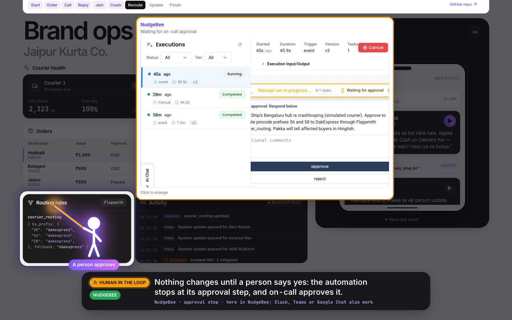
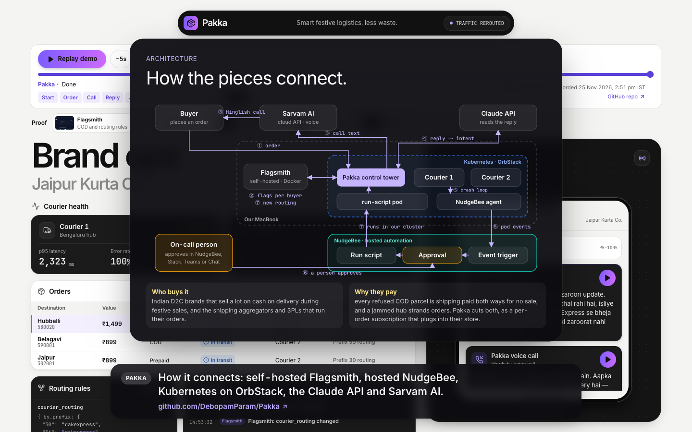
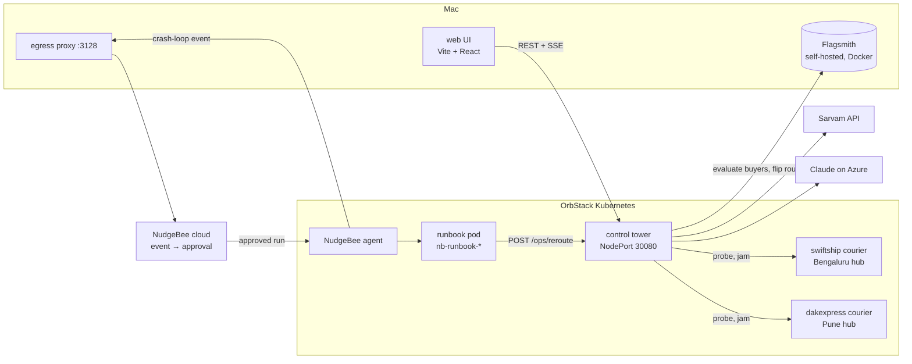

# Pakka

**Smart festive logistics, less waste.** For Indian D2C brands.

<p align="center">
  <a href="https://pakka.debopamchowdhury.com"><b>▶ Watch the live demo: pakka.debopamchowdhury.com</b></a><br/>
  <sub>Press Play, sound on. A narrated replay of a real run.</sub>
</p>



## Problem

Festive peaks waste money: COD parcels come back (shipping paid both ways), courier hubs jam, big carts wait behind small ones.

## What Pakka does

| | How |
|---|---|
| **Fewer wasted returns** | Flagsmith segments the buyer · Sarvam AI confirms risky COD by voice · Claude reads the reply · no COD for repeat returners |
| **High-value carts first** | Flagsmith `peak_priority` sends big carts around a jammed hub |
| **Self-healing routing** | NudgeBee detects the crash loop · a person approves · Flagsmith reroutes live · no deploy |

## Sponsors

- **Flagsmith** (self-hosted): segments, remote config (`courier_routing`, `cod_policy`, `peak_priority`), A/B test, kill switch, Admin API.
- **NudgeBee**: crash-loop detection → approval (NudgeBee UI; Slack, Teams or Google Chat also work) → run script in our cluster.
- **Sarvam AI**: Hinglish voice (Bulbul TTS, Saaras STT).
- Also: Claude API for reply intent, Kubernetes on OrbStack.

## Who buys it

COD-heavy D2C brands, shipping aggregators and 3PLs. Per-order subscription.



## Architecture



Why it is split this way, and what else we considered, is in [notes/decisions.md](notes/decisions.md).

## Run it

### Just the UI (no setup)

```sh
cd web && npm ci && npm run dev
```

Open the printed URL with `?mock=1`. The mock plays the whole story, including a scripted NudgeBee approval.

### The full stack

Needs macOS with [OrbStack](https://orbstack.dev) (Docker and Kubernetes enabled), Node 22, and `kubectl`.

1. **Flagsmith:** `docker compose -f flagsmith/docker-compose.yml up -d`, then create an admin user, a project and an
   environment in the UI at http://localhost:8000, and an Organisation API key. Put it in
   `flagsmith/.local-admin.env` as `FLAGSMITH_MASTER_API_KEY=...` (git-ignored). If your project id or environment
   key differ from ours, set `FLAGSMITH_PROJECT_ID` and `FLAGSMITH_ENV_KEY`, and change `FLAGSMITH_ENV_KEY` in
   `k8s/20-control-tower.yaml`.
2. **Flags:** `node scripts/flagsmith-setup.mjs` creates the flags, segments, overrides and A/B test. Re-running it
   resets the values.
3. **Keys:** create `.env` in the project root (git-ignored). All are optional; without them the voice is marked
   "simulated" and intent falls back to keywords.
   ```
   SARVAM_API_KEY=...
   AZURE_ANTHROPIC_ENDPOINT=https://<resource>.openai.azure.com/anthropic
   AZURE_ANTHROPIC_KEY=...
   ```
4. **Deploy:** `./scripts/deploy.sh` builds the images and deploys the couriers and the control tower to namespace
   `pakka`. The keys go into the Kubernetes Secret `pakka-secrets`; they are never printed or committed.
5. **NudgeBee:** install the NudgeBee agent in the cluster, then import
   [nudgebee/pakka-hub-reroute.json](nudgebee/pakka-hub-reroute.json) as an automation and publish it.
   If containers can't upload to NudgeBee reliably (we saw `tls: bad record MAC` from OrbStack on a phone hotspot),
   run `node scripts/egress-proxy.mjs` and set `HTTPS_PROXY=http://host.orb.internal:3128` (with `NO_PROXY` for
   cluster addresses) on the agent's workloads. The control tower's manifest already uses this proxy (see Known
   limits), so start it before step 4 on such a network.
6. **UI:** `cd web && npm ci && npm run dev`, open the printed URL.

**Demo:** New order → play the call → "Haan, bhej do" → Jam Bengaluru hub → approve in NudgeBee (Automations →
pakka-hub-reroute → Executions) → the orders move to DakExpress and the buyer hears the update.
**Reset:** `./scripts/reset-demo.sh`.

## Known limits

- **One NudgeBee run per crash loop.** NudgeBee groups repeat crash loops of the same workload for about half an
  hour, so a second jam soon after the first won't start a new run. The automation also has a manual trigger
  ("Run current"), which runs the same approval and script.
- **`/ops/reroute` has no caller authentication.** It is reachable through the NodePort. In production we would
  restrict it to the runbook (network policy or mTLS) instead of putting a token in the automation.
- **The trigger matches any crash loop in `pakka`,** not only SwiftShip. Fine for the demo, where only SwiftShip jams.
- **The Flagsmith compose file is Flagsmith's local quick start** and has placeholder secrets. Local use only.
- **Sarvam** bills per character, so the control tower synthesises each spoken line once and replays it from memory.
  Without credits or a key, voice shows as "simulated".
- **Outbound HTTPS from the cluster goes through the Mac's egress proxy.** `k8s/20-control-tower.yaml` sets
  `HTTPS_PROXY` for the control tower; without the proxy running, Sarvam and Claude calls fail (Claude falls back to
  keywords). Remove those env lines on a network where containers reach the internet directly.
- **Recover** after a jam can take a while: the crashed courier only accepts the call between restarts.
  `reset-demo.sh` is the reliable way back.

## AI assistance (disclosure)

This project was built with AI coding assistants, as the rules allow:

- **Claude Code (Claude Opus 5.5)** was the main assistant: architecture, NudgeBee and Flagsmith integration,
  debugging (the crash-loop detection and the OrbStack network fault), code review of every change, and these docs.
- Sub-agents wrote first drafts: the control tower and courier mocks (Claude Opus 5.5), the web UI (OpenAI
  gpt-6.2-sol via Codex), and an independent code review (gpt-6.2-astra).
- The UI uses the "Quiet Motion" design kit in `design/quiet-motion/`.

Every change was read and tested before it was committed. [notes/decisions.md](notes/decisions.md) records why each
choice was made and the routes we didn't take.
