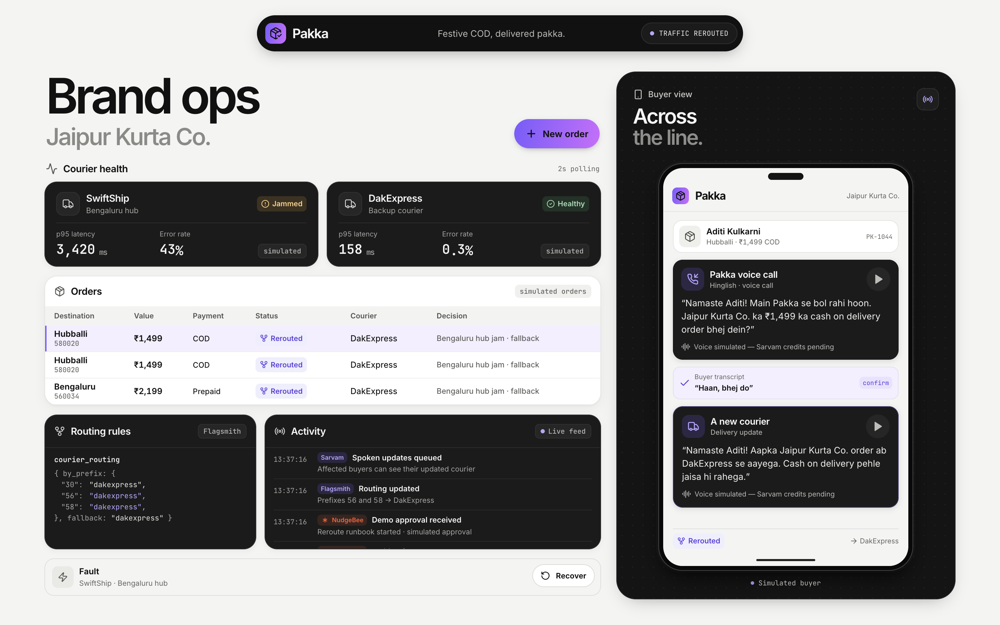
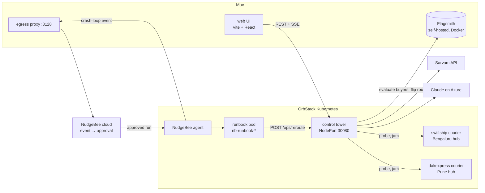

# Pakka — smart festive logistics, less waste

**Live demo (press Play, sound on): https://pakka.debopamchowdhury.com** — a narrated replay of a real recorded run.

Pakka is a logistics control tower for Indian D2C brands in the festive rush. Shipping is free for the buyer, so when
a cash-on-delivery (COD) parcel comes back unopened (RTO), the brand pays shipping both ways. Pakka cuts failed COD
deliveries, sends high-value carts first at peak, and reroutes around jammed courier hubs live, with a person
approving each fix in NudgeBee (Slack, Teams or Google Chat also work).

**Who buys it:** D2C brands that sell heavily on COD during festive sales, and the shipping aggregators and 3PLs that
run their orders, as a per-order subscription.

Built solo at **Festive Hacks**, BIEC Bengaluru, 25 Nov 2026.



## The demo story

1. A Jaipur kurta brand ships a ₹1,499 Diwali COD order to Aditi, a first-time buyer in Hubballi (580020).
2. **Flagsmith** decides she is a risky first COD order, so Pakka calls her in Hinglish (**Sarvam**). She says
   "haan, bhej do", and **Claude** reads that as a confirmation.
3. The courier's Bengaluru hub jams. Its service starts crashing and Kubernetes shows a crash loop.
4. **NudgeBee** detects the crash loop on its own, starts the reroute runbook and waits for a human to approve.
5. On approval, the runbook calls Pakka inside the cluster. Pakka changes the routing in Flagsmith, moves the
   in-flight orders to the backup courier, and tells each buyer in Hinglish.

Everything courier-related is simulated and labelled as such: no real courier APIs, calls or payments.

## How each sponsor is used

| Sponsor | What it does in Pakka |
|---|---|
| **Flagsmith** (self-hosted) | Holds the live logistics rules. `courier_routing` (pincode prefix → courier, plus a fallback) and `cod_policy` are remote config. Segments change the COD policy per buyer: `repeat_buyer` skips the voice check, and `risky_first_cod` (first order, high-RTO pincode) always gets a call and a lower COD cap. `prepaid_nudge` is a 50/50 A/B test (₹50 off vs free gift wrap), and `voice_confirm_enabled` is a kill switch. NudgeBee's approved runbook flips `courier_routing` through the Admin API, and the dashboard shows every flag change, including edits made in Flagsmith's UI. |
| **NudgeBee** | Watches the cluster. Its own crash-loop detection raises the event, and the `pakka-hub-reroute` automation (event trigger → approval → script) runs the fix after a human approves. The script runs inside our cluster and calls Pakka; Pakka alone holds the Flagsmith key. |
| **Sarvam AI** | Bulbul text-to-speech (`bulbul:v4-flash`, Hinglish) for the COD confirmation call and the reroute update. Saaras speech-to-text (`saaras:v4`, `codemix`) for the buyer's spoken reply. |

Claude (Opus 5.5 on Azure) classifies the buyer's reply as confirm, cancel, reschedule or unclear. A keyword fallback
runs without it, and it reads "haan, koi problem nahi, bhej do" as a cancellation because of "nahi". That is why the
LLM is there.

## Architecture



Why it is split this way, and what else we considered, is in [notes/decisions.md](notes/decisions.md).

## Run it

### Just the UI (no setup)

```sh
cd web && npm ci && npm run dev
```

Open the printed URL with `?mock=1`. The mock plays the whole story, including a scripted NudgeBee approval.

### The full stack

Needs macOS with [OrbStack](https://orbstack.dev) (Docker and Kubernetes enabled), Node 22, and `kubectl`.

1. **Flagsmith:** `docker compose -f flagsmith/docker-compose.yml up -d`, then create an admin user, a project and an
   environment in the UI at http://localhost:8000, and an Organisation API key. Put it in
   `flagsmith/.local-admin.env` as `FLAGSMITH_MASTER_API_KEY=...` (git-ignored). If your project id or environment
   key differ from ours, set `FLAGSMITH_PROJECT_ID` and `FLAGSMITH_ENV_KEY`, and change `FLAGSMITH_ENV_KEY` in
   `k8s/20-control-tower.yaml`.
2. **Flags:** `node scripts/flagsmith-setup.mjs` creates the flags, segments, overrides and A/B test. Re-running it
   resets the values.
3. **Keys:** create `.env` in the project root (git-ignored). All are optional; without them the voice is marked
   "simulated" and intent falls back to keywords.
   ```
   SARVAM_API_KEY=...
   AZURE_ANTHROPIC_ENDPOINT=https://<resource>.openai.azure.com/anthropic
   AZURE_ANTHROPIC_KEY=...
   ```
4. **Deploy:** `./scripts/deploy.sh` builds the images and deploys the couriers and the control tower to namespace
   `pakka`. The keys go into the Kubernetes Secret `pakka-secrets`; they are never printed or committed.
5. **NudgeBee:** install the NudgeBee agent in the cluster, then import
   [nudgebee/pakka-hub-reroute.json](nudgebee/pakka-hub-reroute.json) as an automation and publish it.
   If containers can't upload to NudgeBee reliably (we saw `tls: bad record MAC` from OrbStack on a phone hotspot),
   run `node scripts/egress-proxy.mjs` and set `HTTPS_PROXY=http://host.orb.internal:3128` (with `NO_PROXY` for
   cluster addresses) on the agent's workloads. The control tower's manifest already uses this proxy (see Known
   limits), so start it before step 4 on such a network.
6. **UI:** `cd web && npm ci && npm run dev`, open the printed URL.

**Demo:** New order → play the call → "Haan, bhej do" → Jam Bengaluru hub → approve in NudgeBee (Automations →
pakka-hub-reroute → Executions) → the orders move to DakExpress and the buyer hears the update.
**Reset:** `./scripts/reset-demo.sh`.

## Known limits

- **One NudgeBee run per crash loop.** NudgeBee groups repeat crash loops of the same workload for about half an
  hour, so a second jam soon after the first won't start a new run. The automation also has a manual trigger
  ("Run current"), which runs the same approval and script.
- **`/ops/reroute` has no caller authentication.** It is reachable through the NodePort. In production we would
  restrict it to the runbook (network policy or mTLS) instead of putting a token in the automation.
- **The trigger matches any crash loop in `pakka`,** not only SwiftShip. Fine for the demo, where only SwiftShip jams.
- **The Flagsmith compose file is Flagsmith's local quick start** and has placeholder secrets. Local use only.
- **Sarvam** bills per character, so the control tower synthesises each spoken line once and replays it from memory.
  Without credits or a key, voice shows as "simulated".
- **Outbound HTTPS from the cluster goes through the Mac's egress proxy.** `k8s/20-control-tower.yaml` sets
  `HTTPS_PROXY` for the control tower; without the proxy running, Sarvam and Claude calls fail (Claude falls back to
  keywords). Remove those env lines on a network where containers reach the internet directly.
- **Recover** after a jam can take a while: the crashed courier only accepts the call between restarts.
  `reset-demo.sh` is the reliable way back.

## AI assistance (disclosure)

This project was built with AI coding assistants, as the rules allow:

- **Claude Code (Claude Opus 5.5)** was the main assistant: architecture, NudgeBee and Flagsmith integration,
  debugging (the crash-loop detection and the OrbStack network fault), code review of every change, and these docs.
- Sub-agents wrote first drafts: the control tower and courier mocks (Claude Opus 5.5), the web UI (OpenAI
  gpt-6.2-sol via Codex), and an independent code review (gpt-6.2-astra).
- The UI uses the "Quiet Motion" design kit in `design/quiet-motion/`.

Every change was read and tested before it was committed. [notes/decisions.md](notes/decisions.md) records why each
choice was made and the routes we didn't take.
